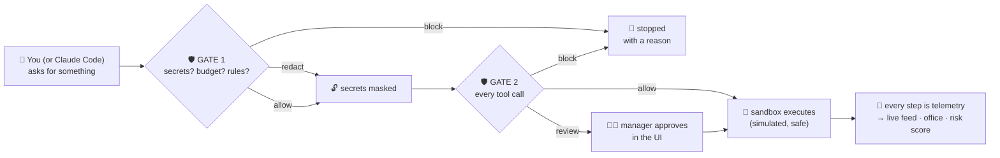

<div align="center">

# 🛡️ AgentShield

### An airport security checkpoint for AI coding agents — with a digital-twin office on top.

**Every model call passes Gate 1. Every tool call passes Gate 2. Every decision
is explained, recorded, and scored for risk.**

[](https://www.python.org/)
[](https://fastapi.tiangolo.com/)
[](https://react.dev/)
[](https://phaser.io/)
[](LICENSE)

[What is this?](#-what-is-agentshield) · [30-second tour](#-the-30-second-tour) ·
[Quickstart](#-quickstart) · [Plug in Claude Code](#-plug-in-your-coding-agent) ·
[Docs](#-documentation)

</div>

---

The Nebius × NVIDIA Autopilot coding demo has a [setup and judge walkthrough](docs/AUTOPILOT-DEMO.md). It requires Docker, a live Nebius key, and a private demo token.

## Autopilot judge quickstart

Prerequisites: Python 3.11+, Node 20+, and Docker with a running Linux-container
daemon. From the repository root, run `python tasks.py setup` and
`python tasks.py seed`. Setup installs API and frontend dependencies.

Add these values to `services/api/.env` (or export them in the backend shell):

```dotenv
NEBIUS_API_KEY=your-token-factory-key
NEBIUS_MODEL=nvidia/nemotron-3-super-120b-a12b
AUTOPILOT_DEMO_TOKEN=choose-a-private-random-token
```

Keep the simulator's `LLM_PROVIDER` as configured; Autopilot always uses Nebius.
The example values are placeholders. Never commit the actual secrets.

```bash
# Offline Docker verification; builds the image if absent (initial build needs internet)
services/api/.venv/bin/python scripts/verify_docker_runner.py
# Backend (terminal 1)
python tasks.py api
# Frontend (terminal 2)
python tasks.py web
```

On Windows use `services/api/.venv/Scripts/python.exe` for the helper.
Open `http://localhost:5173/autopilot`, enter your demo token and load fixtures.
Without a Nebius key, discovery still works and a setup card explains how to
enable jobs. The API rejects creation/status/reset with HTTP 422 and a clear
`detail` message before starting any work. With a key, first run
`python tasks.py nebius-smoke`, then use the three fixtures and download reports.
Events use cursor polling (`since_seq`), not SSE. OpenAPI is at
`http://localhost:8000/openapi.json`.

See [submission disclosure](docs/HACKATHON-SUBMISSION.md) and
[timed demo script](docs/AUTOPILOT-DEMO.md). Live inference remains unverified
until actual credentials and Docker are available.

## 🤔 What is AgentShield?

AI coding agents are incredibly useful — and completely unsupervised. They can
leak secrets into prompts, `git push` to main at 3 a.m., read `.env.production`
"just to check the config", or loop on an expensive API until the bill arrives.

**AgentShield sits between your agents and everything they touch.**

| | |
|---|---|
| 🛡️ **Two gates, not one** | Gate 1 checks the *request* before the model call. Gate 2 re-checks *every tool call* before it executes. |
| ⚖️ **Four honest decisions** | `allow` · `redact` (mask secrets) · `review` (a human approves) · `block`. Precedence is fixed: block always wins. |
| 🏢 **A digital-twin office** | 20 AI employees in an isometric office. ~90% run on **real LLM brains** (Groq, free) with local Ollama and a scripted fallback chain. |
| 🧪 **A no-sign-in Sandbox** | Pick a role (intern → devops), type a prompt, attempt a tool call — watch the gates decide and *explain themselves*. |
| 🚨 **A risk engine with a hidden adversary** | One employee is secretly following an attack ladder. The detector must find them from telemetry alone — without peeking at labels (physically enforced). |
| 🔌 **One rulebook, three doors** | The office, the Sandbox, and your real Claude Code/Codex/MCP agents obey the *same* policies. Change a rule once — everything obeys. |
| 🏠 **Local-first, AWS-ready** | Runs fully offline on a laptop. Flipping to AWS is one env var, enforced by architecture tests. |

> **The one-sentence pitch:** *it's the checkpoint, the CCTV system, and the
> training simulator — in one deploy.*

---

## 🎬 The 30-second tour



Ask an intern to deploy to production? **Blocked** — `pol_intern_no_prod_deploy`.
Ask anyone to read `.env.production`? **Blocked** — `pol_block_secret_read`.
Put an AWS key in a prompt? **Redacted** — `<<REDACTED:aws_access_key:1a5d>>`.
DevOps deploys to production? **Review** — a manager clicks approve.

---

## 🚀 Quickstart

> **Requirements:** Python 3.11+, Node 20+. No AWS account, no API keys needed
> to start — everything works offline by default.

```bash
# 1. Setup (backend venv + web deps + .env)
python tasks.py setup

# 2. Seed the company: 20 employees, 6 repos, 13 policies
python tasks.py seed

# 3. Generate 14 days of history so risk baselines exist
python tasks.py seed-history

# 4. Run it: API on :8000, office on :5173
python tasks.py dev
```

Open **http://localhost:5173** → you land in the office. Press
**▶ REAL TIME** and the employees start working.

### Give the bots real brains (still free, ~2 minutes)

```bash
brew install ollama && ollama serve &          # local tier (optional)
ollama pull qwen2.5-coder:1.5b && ollama pull qwen2.5-coder:7b
```

Get a free API key at [console.groq.com](https://console.groq.com) (no credit
card), then in `.env`:

```env
LLM_PROVIDER=hybrid
LLM_CLOUD_API_KEY=gsk_…                        # cloud tier
SIM_LLM_INVOCATION_RATE=0.40                   # share of sessions using a real model
```

No key? No problem — the hybrid chain degrades **Ollama → scripted mock**, and
the telemetry honestly records which tier answered (`fallback=true`).

### Or skip straight to the Sandbox

Open **http://localhost:5173/sandbox** — no sign-in. Pick **Engineering
Intern**, click **Deploy → production**, and read the refusal.

---

## 🔌 Plug in your coding agent

One universal endpoint governs anything that can make an HTTP call:

```bash
curl -X POST http://localhost:8000/api/v1/playground/hook/agent \
  -H "Content-Type: application/json" \
  -d '{"mode":"demo","role":"engineering_intern",
       "tool":"deploy","args":{"environment":"production"},"task":"Ship it"}'
```

```json
{"decision": "block",
 "reason": "Production deployment is not available at this level.",
 "policy_ids": ["pol_intern_no_prod_deploy", "pol_prod_deploy_requires_manager"]}
```

| Agent | How | File |
|---|---|---|
| **Claude Code** | PreToolUse hook — every tool call governed natively | `infra/scripts/claude_hook.py` |
| **Codex CLI** | Exit-code approval hook | `infra/scripts/codex_hook.py` |
| **Antigravity / Cursor / Windsurf / any MCP client** | MCP server with the `agentshield_gate` tool | `infra/mcp/agentshield_mcp_server.py` |
| **Anything else** | Plain HTTP (above) | — |

Full walkthroughs (including `.claude/settings.json` and `~/.codex/config.toml`
snippets): **[docs/09-AGENT-INTEGRATION.md](docs/09-AGENT-INTEGRATION.md)**.

---

## 🖥️ What you get

<details open>
<summary><b>The Office</b> — the digital twin</summary>

An isometric office rendered with Phaser. 20 avatars request work, walk to the
coffee machine, wait with an orange badge when an approval is needed, flash red
when blocked. Click anyone for their live stats, risk score, current task and
recent decisions. It is a *renderer over telemetry* — the API is authoritative,
always.

</details>

<details>
<summary><b>Live Feed & Approvals</b> — the CCTV</summary>

Every decision streams in order. Click a task to see its full trace: gate
decisions with reasons and matched policies, model calls with token counts, and
sandbox results. Pending reviews land on the Approvals page with TTL countdowns.

</details>

<details>
<summary><b>Control Center</b> — the rulebook and the radar</summary>

Write and version policies in a validated editor (typos get "did you mean…?"
suggestions). Test a draft against recorded history in the **Policy Lab**
before enforcing it — it replays real decisions and reports who would be
newly blocked. Watch costs, risk leaderboard, and incidents.

</details>

<details>
<summary><b>Sandbox</b> — the playground</summary>

No sign-in. Pick a role, feel the rulebook. Same gates, same policies, same
simulated sandbox the office bots use.

</details>

---

## 🧪 Verify everything

```bash
python tasks.py check            # lint + types + tests + web build (both sides)
python tasks.py test-contract    # port contracts vs local AND aws (moto) — skips fail
python tasks.py check-secrets    # canary scan: raw secrets in storage MUST be 0
python tasks.py evaluate         # detection metrics vs the hidden adversary
python tasks.py demo             # unattended 5-beat demo with risk table
```

Current state: **120 backend tests · 104 contract tests · mypy strict ·
zero TS errors.**

---

## 📚 Documentation

| Doc | What's inside |
|---|---|
| **[docs/architecture.md](docs/architecture.md)** | 🏛️ The whole architecture in plain English — every layer, every flow, every invariant, with diagrams. **Start here.** |
| **[docs/GUIDE.md](docs/GUIDE.md)** | 🗺️ Operating manual — how to run it, drive it, integrate Claude Code/Codex, and test everything. |
| **[docs/09-AGENT-INTEGRATION.md](docs/09-AGENT-INTEGRATION.md)** | 🔌 Agent integration deep-dive. |
| **[docs/graph/GRAPH.md](docs/graph/GRAPH.md)** | 🗺️ The codebase map for agents & contributors. |
| **[docs/00-MASTER-PROMPT.md](docs/00-MASTER-PROMPT.md)** | 📜 The original spec (read this before changing architecture). |
| **[PROGRESS.md](PROGRESS.md)** | 🧾 Build log and deviations. |

---

## 🧭 Repository layout

```
Agent-Shield-/
├── services/api/          🐍 FastAPI backend (gates, sim, risk, telemetry)
├── apps/web/              ⚛️ React 19 + Phaser console (office + console UI)
├── packages/contracts/    📐 Shared event schemas → generated TS + Pydantic
├── infra/
│   ├── mcp/               🔌 MCP server (agentshield_gate)
│   └── scripts/           🪝 Claude Code / Codex hooks, evaluation, exports
├── scenarios/             🎬 Demo beat sheets
└── docs/                  📚 You are here
```

---

<div align="center">

**Built to answer one question:** *when an AI agent does something, who checks
it?*

🛡️ AgentShield: now somebody does.

</div>
