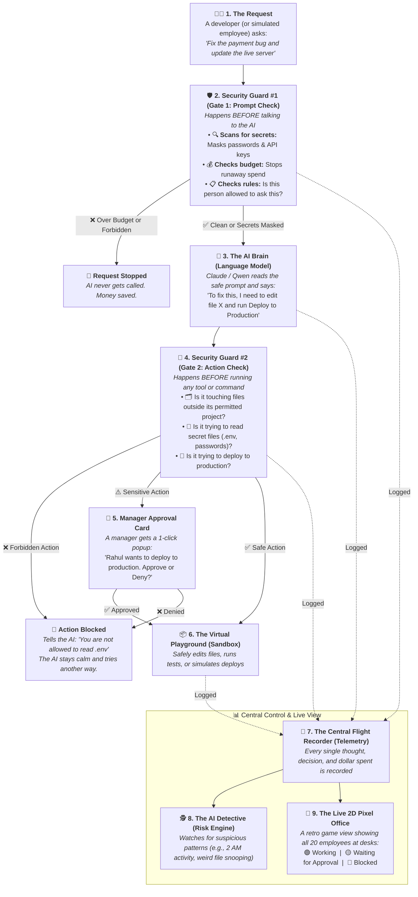

# AgentShield — Plain-English Architecture & Data Flow Guide

> **What is this document?**  
> An easy-to-understand explanation of how AgentShield works, how data moves through it, and how it keeps AI coding assistants safe. Written in **plain English** (layman's terms) with simple diagrams, real-life analogies, and step-by-step examples.

---

## 1. The Big Picture: What is AgentShield?

Imagine you hired 20 new programmers, but they are all **autonomous AI robots**. 
They write code at lightning speed, but:
- They might accidentally paste company passwords or credit card keys into their prompts.
- They might try to deploy untested code directly to the live production website.
- An attacker might trick an AI into secretly reading sensitive employee files.
- An intern's AI might get stuck in an infinite loop and rack up a $10,000 cloud bill over the weekend.

**AgentShield is an Airport Security Checkpoint for AI coding assistants.**

Just like at an airport where you go through:
1. **Ticket & Baggage Check (Gate 1):** Checks who you are, what you are carrying, and confiscates dangerous items before you board.
2. **Boarding Gate (Gate 2):** Checks your passport one more time right before you step onto the plane, and calls a manager if something looks unusual.

AgentShield inspects the AI **twice**: once *before* it talks to the AI brain, and once *before* it runs any command on your computers.

---

## 2. The Simple Data Flow Diagram

Here is how data flows through AgentShield from start to finish:



---

## 3. The 7 Steps Explained in Plain English

### Step 1: The Request Arrives
Data enters AgentShield from one of two sources:
- **The Digital Twin (Simulation):** A virtual company called "Acme Payments" with 20 simulated employees (interns, engineers, managers, DevOps) working on 6 code repositories.
- **Live Mode (Real World):** A real coding assistant (like Claude Code, Cursor, or an internal AI tool) calling AgentShield's API over the internet.

Both sources look **100% identical** to the security system.

---

### Step 2: Security Guard #1 (Gate 1 — Prompt Inspection)
*Before the request is sent to the AI model:*
1. **Secret Scanner:** AgentShield looks for 7 types of leaked secrets (like AWS keys, database passwords, private encryption keys, or login tokens). If it finds one, it **masks it** (e.g. replacing `AKIA1234567890` with `«REDACTED:aws_key:a3f9»`). The raw secret is locked in a secure vault and never sent to the AI company.
2. **Budget Estimator:** It calculates how many words the AI will read and write, looks up the price, and checks: *"Does this intern have enough daily budget left?"* If not, it halts the request immediately.
3. **Company Rulebook:** It checks custom company rules (e.g. *"Interns cannot use expensive frontier AI models for simple spelling fixes"*).

**Outcomes:**  
- **Allow:** Clean request proceeds to the AI.
- **Redact:** Secret is stripped out; safe version proceeds to the AI.
- **Review:** Held until a manager approves.
- **Block:** Request is rejected.

---

### Step 3: The AI Brain (Model Router)
The safe, cleaned prompt is sent to the AI model:
- Simple tasks get sent to fast, lightweight models (cheap & fast).
- Complex coding tasks get sent to heavyweight models (smart & thorough).

The AI reads the prompt and replies: *"Here is my plan: I need to read the database config file, edit line 42, and deploy the code."*

---

### Step 4: Security Guard #2 (Gate 2 — Action Inspection)
*Before the AI is allowed to actually touch any file or run any command:*
Every single tool the AI wants to use (`read_file`, `edit_file`, `run_tests`, `git_push`, `deploy`, etc.) is intercepted.

1. **Scope Check:** Does this engineer work on this repository? (An intern working on the frontend website shouldn't touch the core payment gateway).
2. **Secret Path Check:** Is the AI trying to open `.env` or `passwords.txt`? If yes, it is instantly blocked.
3. **Danger Level Check:** Is the AI trying to push code directly to the `main` branch or deploy straight to live production?

**Outcomes:**
- **Allow:** Safe actions (like running automated tests or editing safe files) run immediately.
- **Review:** Dangerous actions (like deploying to production) pause the AI and send a notification card to the team manager.
- **Block:** Forbidden actions are refused. **Crucially: AgentShield does not crash the AI.** It politely tells the AI: *"Access Denied by Policy: You cannot read production secrets."* The AI stays running and tries an alternate solution.

---

### Step 5: The Virtual Playground (Sandbox)
When an action is approved, it runs inside a safe **virtual sandbox**:
- Files are edited in a simulated filesystem.
- Git commits and test runs happen safely in memory.
- Nothing can break your real cloud servers during simulations.

---

### Step 6: The Central Flight Recorder (Telemetry Emitter)
Every single event that happens in the entire system passes through one central "Flight Recorder":
- It stamps every event with an official ticket number (1, 2, 3, 4...).
- It writes the event into the database so it can never be altered or erased.
- It broadcasts the event live to the manager console and the visual screen.

---

### Step 7: The AI Detective (Risk & Anomaly Engine)
While work is happening, an automated background detective watches the flight recorder:
- It tracks what is "normal" for each person over 14 days (e.g. how many tokens they use, what hours they work, which repos they touch).
- It calculates a **Risk Score from 0 to 100**:
  - **Static Risk:** How dangerous is the action itself? (Deploying to prod = high risk; running a test = low risk).
  - **Behavioral Risk:** Is this weird for this person? (An intern working at 3:00 AM on a repo they've never seen before).
  - **AI Anomaly Detection:** Machine learning spots complex hidden patterns.
- If an employee's risk score goes above **70**, AgentShield automatically opens a **Security Incident** with full evidence for the security team.

---

## 4. Real-Life Story Examples

To see how this works in practice, here are three everyday scenarios:

### Scenario A: The Accidental Secret Leak
```
Rahul (Intern) -> Prompts AI: "Connect to database postgres://admin:P@ssword123@db.acme.com"
      ↓
Gate 1 intercepts: "Found a raw database password!"
      ↓
Action: Replaces password with «REDACTED:password:e8b2»
      ↓
Model receives: "Connect to database postgres://admin:«REDACTED:password:e8b2»@db.acme.com"
      ↓
Result: The database password is never leaked to third-party AI servers.
```

### Scenario B: The Production Deploy
```
Maya (Engineer) -> AI decides to run: deploy(environment="production")
      ↓
Gate 2 intercepts: "Production deployment requires Manager approval."
      ↓
Status changes to: AWAITING APPROVAL (Maya's avatar turns yellow on screen)
      ↓
Manager (Ben) receives a 1-click notification card showing:
  • Who: Maya
  • Action: Deploy to Production
  • Risk Score: 24 (Low / Normal)
  • Cost so far: $0.42
      ↓
Ben clicks [Approve]
      ↓
Agent resumes immediately and finishes the deploy.
```

### Scenario C: The Insider Attacker
```
Adversarial Actor -> Tries reading 5 different secret files across 3 unrelated projects at 2 AM
      ↓
Gate 2 blocks each secret file read attempt
      ↓
Flight recorder notes: 5 blocked attempts + off-hours activity + unusual repos
      ↓
AI Detective computes:
  • Token spike z-score: High
  • Sensitive file probing: High
  • Off-hours fraction: 100%
  • Composite Risk Score: 88 / 100 (> 70 threshold)
      ↓
System automatically triggers: "INCIDENT #402: Potential Credential Harvesting Detected"
      ↓
Avatar in the 2D office turns RED; security team gets instant evidence trail.
```

---

## 5. How the Pieces Fit Together (Architecture Map)

Here is how the software is organized behind the scenes:

```
┌────────────────────────────────────────────────────────────────────────┐
│ 1. THE FRONTEND (What the user sees in the browser)                   │
│                                                                        │
│  [🏢 2D Virtual Office]      [📋 Live Event Feed]   [🔔 Approvals Queue]│
│   Retro pixel art showing     Real-time scrolling     1-click approve/  │
│   20 avatars at desks         table of every event    deny for managers │
│                                                                        │
│  [📊 Control Center]         [🧪 Policy Lab]        [💰 Cost & Waste]  │
│   Security leaderboard &      Test new rules on       See money spent   │
│   active incidents            past data (What-if)     vs money wasted   │
└───────────────────────────────────┬────────────────────────────────────┘
                                    │
                  Real-time updates via WebSockets & REST
                                    │
┌───────────────────────────────────▼────────────────────────────────────┐
│ 2. THE BACKEND ENGINE (FastAPI in Python)                              │
│                                                                        │
│  ┌──────────────────────────┐      ┌────────────────────────────────┐  │
│  │ Checkpoint 1 (Gate 1)    │      │ Checkpoint 2 (Gate 2)          │  │
│  │ Secrets, budgets, rules  │      │ Scope, file permissions, tools │  │
│  └─────────────┬────────────┘      └───────────────┬────────────────┘  │
│                │                                   │                   │
│                ▼                                   ▼                   │
│  ┌──────────────────────────┐      ┌────────────────────────────────┐  │
│  │ The Model Router         │      │ The Virtual Sandbox            │  │
│  │ Picks Haiku, Sonnet, or  │      │ Runs code and tools safely     │  │
│  │ local offline models     │      │ without touching real servers  │  │
│  └──────────────────────────┘      └────────────────────────────────┘  │
│                                                    │                   │
│  ┌─────────────────────────────────────────────────▼────────────────┐  │
│  │ The Central Flight Recorder (Telemetry Emitter)                  │  │
│  │ Numbered, un-fakeable log of everything that happens             │  │
│  └─────────────────────────┬────────────────────────────────────────┘  │
│                            │                                           │
│                            ▼                                           │
│  ┌──────────────────────────────────────────────────────────────────┐  │
│  │ The AI Detective (Risk & Anomaly Engine)                         │  │
│  │ Calculates 0-100 risk scores & flags suspicious behavior         │  │
│  └──────────────────────────────────────────────────────────────────┘  │
└────────────────────────────────────┬───────────────────────────────────┘
                                     │
                 Universal Adapters (Runs anywhere)
                                     │
┌────────────────────────────────────▼───────────────────────────────────┐
│ 3. STORAGE & CLOUD (Switch with a single setting)                      │
│                                                                        │
│   LOCAL LAPTOP MODE (No cloud needed):                                 │
│   • Database: Fast local SQLite file                                   │
│   • AI Model: Free offline model (Ollama) or instant Mock AI           │
│   • Storage:  Local files on your hard drive                           │
│                                                                        │
│   AWS ENTERPRISE CLOUD MODE:                                           │
│   • Database: Amazon DynamoDB                                          │
│   • AI Model: Amazon Bedrock (Claude 3.5 Sonnet & Haiku)               │
│   • Storage:  Amazon S3                                                │
└────────────────────────────────────────────────────────────────────────┘
```

---

## 6. The "Universal Travel Plug" Design (Portability)

One of the most important technical achievements in AgentShield is **Zero-Rewrite Portability**:

Think of it like a **Universal Travel Plug Adapter**:
- Your laptop charger (AgentShield's security code) stays exactly the same.
- If you are in the US (Local laptop), you plug into a US socket (SQLite + Ollama).
- If you fly to the UK (AWS Cloud), you snap on the UK plug (DynamoDB + Bedrock).
- **You do not buy a new laptop or rewrite your charger.**

```
                     ╔═════════════════════════════════╗
                     ║   AgentShield Governance Core   ║
                     ║   (Rules, Gates, Risk, Avatars) ║
                     ╚════════════════╦════════════════╝
                                      ║
                          Universal Plug (8 Ports)
                                      ║
                ┌─────────────────────┴─────────────────────┐
                ▼                                           ▼
      [🔌 Local Laptop Plug]                      [☁️ AWS Cloud Plug]
      • SQLite (database)                         • DynamoDB (database)
      • Local hard drive (files)                  • Amazon S3 (files)
      • Ollama / Mock (models)                    • Amazon Bedrock (models)
      • Terminal output (metrics)                 • CloudWatch (metrics)
```

Because of this design, you can run the entire system on a laptop with no internet connection, and deploy it to AWS by changing **one single line** in your config (`AGENTSHIELD_ENV=aws`).

---

## 7. The Policy Lab: "What-If" Time Machine

Imagine a security officer wants to introduce a strict new rule:
> *"Block all coding assistants from modifying files in the payments repository unless they have senior engineer approval."*

In normal companies, enabling that rule might accidentally break the work of 15 innocent engineers. 

In AgentShield, the security lead uses the **Policy Lab**:
1. They type the draft rule into the dashboard.
2. They click **Test against last 24 hours of data**.
3. In under 5 seconds, AgentShield replays all 5,000 historical requests through the new rule.
4. It reports back:
   - *"This rule would have affected 18 requests."*
   - *"It would have saved $42.00 in wasted tokens."*
   - *"It would have generated 2 extra manager approvals per day."*
   - *"0 false positives detected."*
5. The officer can now turn the rule on with 100% confidence.

---

## 8. Summary of Terms

| Everyday Term | Technical Name | What it does |
|---|---|---|
| **Security Guard #1** | Gate 1 (Request Governance) | Checks the prompt for passwords and budget limits before sending to the AI model. |
| **Security Guard #2** | Gate 2 (Action Governance) | Checks commands before running them (stops file theft or unauthorized deployments). |
| **The AI Brain** | Model Router (`LLMPort`) | Sends the request to the right model (Claude 3.5, Qwen, or mock simulator). |
| **Manager Popup** | Approval Engine | Pauses high-risk tasks until a human clicks Approve or Deny. |
| **Virtual Playground** | Virtual Sandbox | Simulates files, git, and testing so AI code can't damage live systems. |
| **Flight Recorder** | Telemetry Emitter | Gives every event an unchangeable ticket number and writes it to the database. |
| **AI Detective** | Risk & Anomaly Engine | Watches for abnormal behavior and computes a 0–100 risk score for every employee. |
| **Digital Twin** | Simulation Engine | Simulates 20 virtual employees so you can test security rules before using them on real people. |
| **2D Pixel Office** | Phaser Game View | A retro game interface showing all 20 avatars working, waiting, or blocked at their desks. |
| **Universal Adapter** | Ports & Adapters Architecture | Allows the exact same code to run on a local laptop (SQLite) or in the cloud (AWS DynamoDB). |
