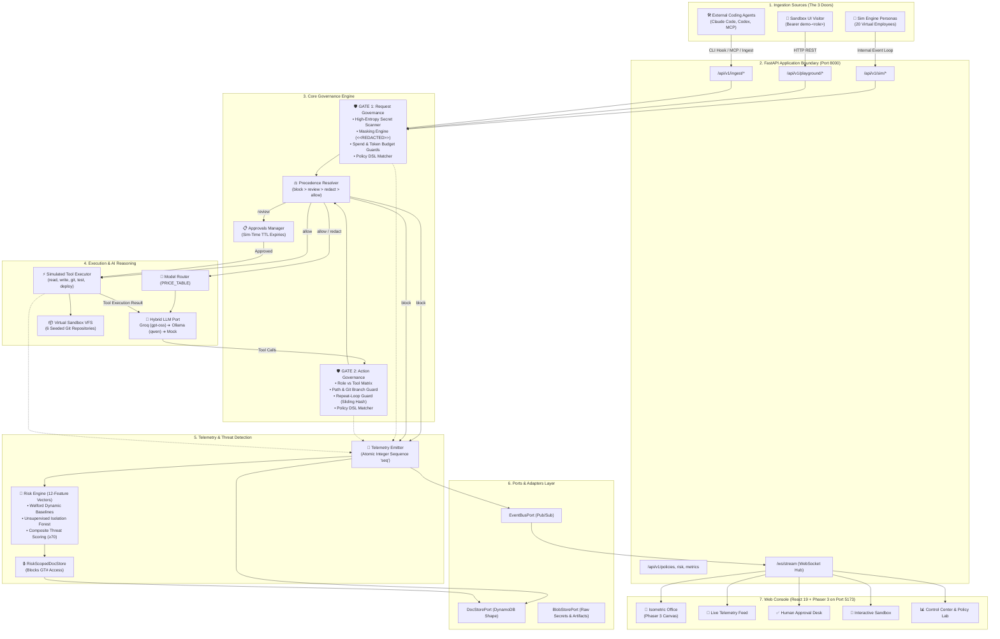
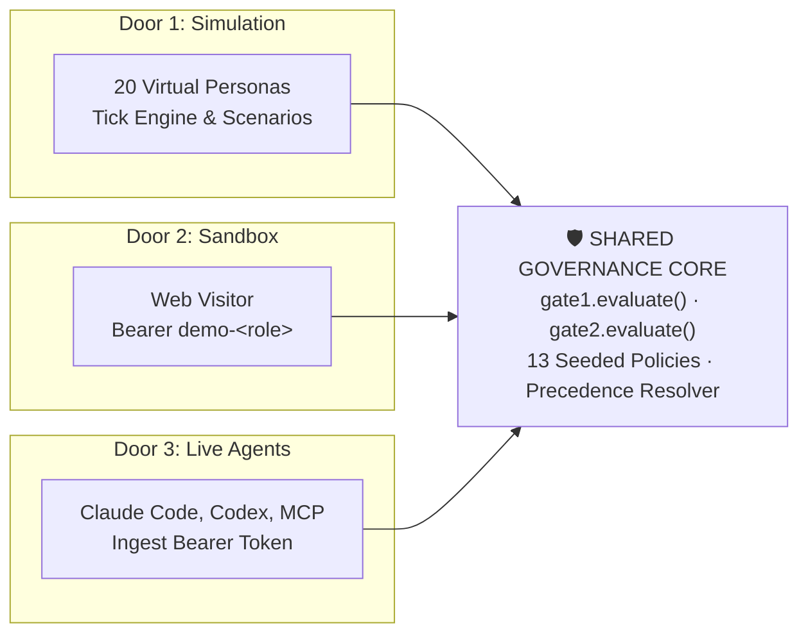
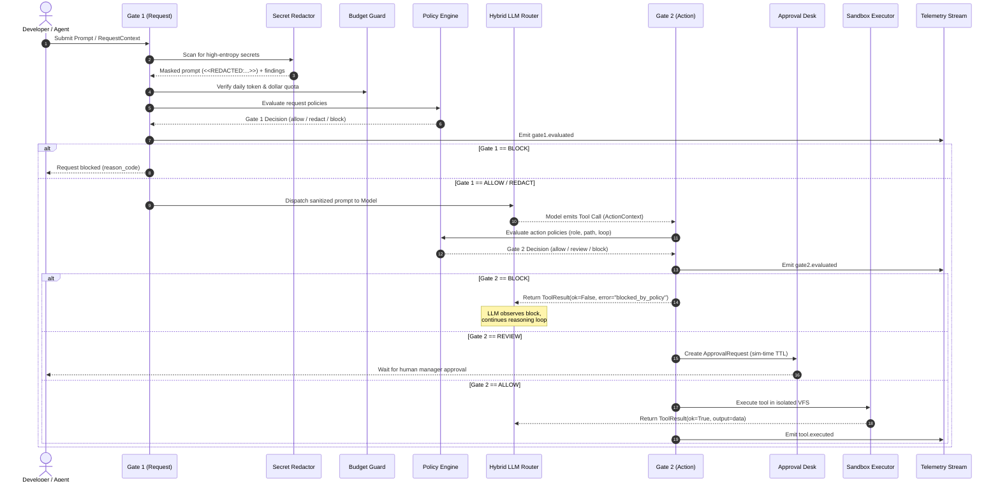
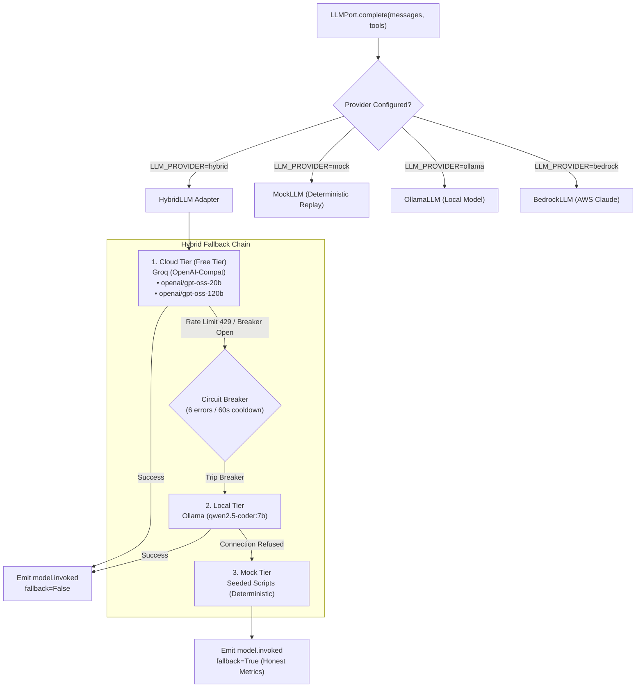
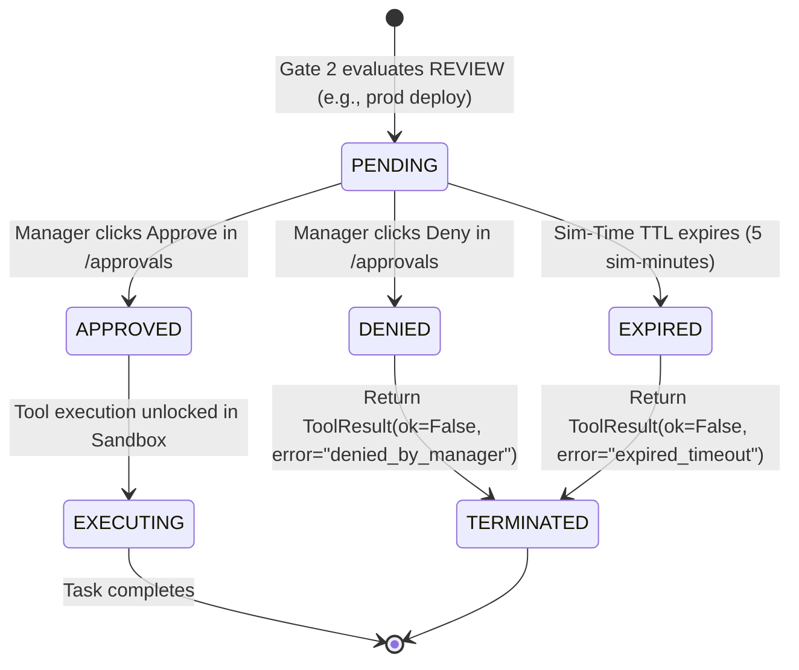
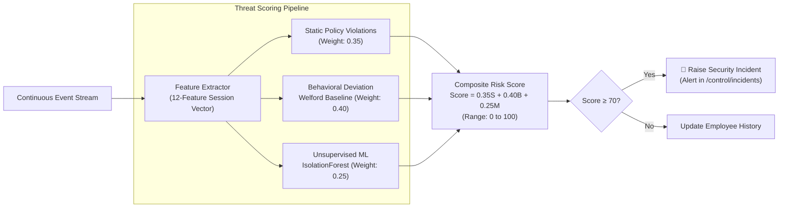

# AgentShield — Architecture & System Design

> **Document Status**: Production Reference Architecture
> **Target Audience**: Core Engineers, Security Architects, AI Agent Developers, and Integrators
> **System Scope**: End-to-end architecture from Frontend (React 19, Phaser 3, Zustand) to Backend (FastAPI, Hexagonal Ports & Adapters, Hybrid LLM, Risk Engine, Sandbox VFS) and External Integrations (Claude Code, Codex, MCP).

---

## Table of Contents

1. [Executive Summary & Core Security Thesis](#1-executive-summary--core-security-thesis)
2. [High-Level System Architecture](#2-high-level-system-architecture)
3. [The Three Ingestion Channels (The Three Front Doors)](#3-the-three-ingestion-channels-the-three-front-doors)
   - [Door 1: Synthetic Simulation Mode (Office Digital Twin)](#door-1-synthetic-simulation-mode-office-digital-twin)
   - [Door 2: Sandbox Playground (`/sandbox`)](#door-2-sandbox-playground-sandbox)
   - [Door 3: Live Agent Integration (Claude Code, Codex, MCP)](#door-3-live-agent-integration-claude-code-codex-mcp)
4. [The Dual-Gate Governance Pipeline](#4-the-dual-gate-governance-pipeline)
   - [Gate 1: Request Governance (Pre-Inference)](#gate-1-request-governance-pre-inference)
   - [Gate 2: Action Governance (Pre-Execution Tool Call)](#gate-2-action-governance-pre-execution-tool-call)
   - [The Four Decisions & Fixed Precedence Engine](#the-four-decisions--fixed-precedence-engine)
   - [The Policy DSL & Append-Only Rulebook](#the-policy-dsl--append-only-rulebook)
5. [The AI Brains & Multi-Tier Model Routing](#5-the-ai-brains--multi-tier-model-routing)
   - [Hybrid Fallback Chain (Cloud → Local → Mock)](#hybrid-fallback-chain-cloud--local--mock)
   - [Complexity Routing & Canonical Price Table](#complexity-routing--canonical-price-table)
   - [Provider Translation & Self-Correction](#provider-translation--self-correction)
6. [The Simulated Sandbox (VFS & Virtual Executor)](#6-the-simulated-sandbox-vfs--virtual-executor)
   - [Virtual File System (VFS) & 6 Seeded Repositories](#virtual-file-system-vfs--6-seeded-repositories)
   - [Simulated Tool Executor](#simulated-tool-executor)
7. [Human-in-the-Loop Approval Workflow](#7-human-in-the-loop-approval-workflow)
8. [Telemetry, Event Sourcing & Storage Architecture](#8-telemetry-event-sourcing--storage-architecture)
   - [The Atomic Telemetry Choke Point](#the-atomic-telemetry-choke-point)
   - [Hexagonal Storage: Dynamo-Shaped SQLite & AWS DynamoDB](#hexagonal-storage-dynamo-shaped-sqlite--aws-dynamodb)
   - [Real-Time WebSocket Stream with Gap Resynchronization](#real-time-websocket-stream-with-gap-resynchronization)
9. [The Risk Engine & Behavioral Anomaly Detection](#9-the-risk-engine--behavioral-anomaly-detection)
   - [12-Dimensional Session Feature Extraction](#12-dimensional-session-feature-extraction)
   - [Per-Employee Dynamic Baselines (Welford's Algorithm)](#per-employee-dynamic-baselines-welfords-algorithm)
   - [Unsupervised Isolation Forest & Composite Scoring](#unsupervised-isolation-forest--composite-scoring)
   - [The Hidden Adversary & Physical Label Isolation](#the-hidden-adversary--physical-label-isolation)
10. [Frontend Architecture (`apps/web`)](#10-frontend-architecture-appsweb)
    - [Application Shell & State Store Topology](#application-shell--state-store-topology)
    - [The Isometric Office Digital Twin (Phaser 3)](#the-isometric-office-digital-twin-phaser-3)
    - [The Live Audit Feed (`/live`)](#the-live-audit-feed-live)
    - [The Approvals Queue (`/approvals`)](#the-approvals-queue-approvals)
    - [The Developer Sandbox (`/sandbox`)](#the-developer-sandbox-sandbox)
    - [The Control Center Suite (`/control`)](#the-control-center-suite-control)
11. [Architectural Guarantees, Contracts & Invariants](#11-architectural-guarantees-contracts--invariants)
12. [Repository Directory & File Guide](#12-repository-directory--file-guide)

---

## 1. Executive Summary & Core Security Thesis

Autonomous AI coding agents (Claude Code, OpenAI Codex, Antigravity, Cursor, Windsurf) operate with direct terminal access, file read/write permissions, and network privileges. Left unsupervised, agents frequently:
- Leak confidential credentials (AWS keys, database passwords, JWTs) into public model context windows.
- Push breaking changes directly to protected `main` / `master` git branches during off-hours.
- Inspect production environment secrets (`.env.production`, `credentials.json`) out of curiosity or task misinterpretation.
- Enter infinite retry loops against failing or expensive cloud APIs, incurring runaway infrastructure bills.

**AgentShield is an airport security checkpoint for AI coding agents.**

It enforces security through five foundational principles:

```
                    ┌────────────────────────────────────────────────────────┐
                    │                   AGENTSHIELD CORE                     │
                    │   Dual-Gate Governance · Risk Engine · Telemetry Stream│
                    └───────────────────────────┬────────────────────────────┘
                                                │
         ┌──────────────────────────────────────┼──────────────────────────────────────┐
         ▼                                      ▼                                      ▼
┌──────────────────┐                  ┌──────────────────┐                  ┌──────────────────┐
│ SIMULATION MODE  │                  │ SANDBOX PLAYGROUND│                  │    LIVE MODE     │
│ 20 virtual bots  │                  │ Browser Dev UI   │                  │ Claude Code,     │
│ in pixel office  │                  │ Bearer demo-role │                  │ Codex, MCP tools │
└──────────────────┘                  └──────────────────┘                  └──────────────────┘
```

1. **Dual-Gate Enforcement**: Security cannot be solved solely at the prompt level. Prompt filtering stops obvious jailbreaks, but malicious or misguided tool actions occur *turns later* during agent execution. AgentShield places **Gate 1** before model inference and **Gate 2** before every single tool action.
2. **Fixed Decision Precedence**: When multiple security policies trigger, the outcome is mathematically determined by a strict hierarchy: `BLOCK > REVIEW > REDACT > ALLOW`. If one policy allows an action and another blocks it, **block always wins**.
3. **Fail-Closed Design**: If any governance component, parser, or policy check raises an unhandled exception, the transaction fails closed as a **BLOCK** (`gate_error`). It never fails open.
4. **Adversarial Observability (Block as Tool Result)**: When Gate 2 blocks an agent tool action, it **does not throw an exception or terminate the process**. Instead, it synthesizes an informative error payload as the tool's result (e.g., `blocked_by_policy: pol_block_secret_read`). This allows the LLM agent to observe the refusal, rethink its approach, and potentially attempt alternative maneuvers. An agent that gracefully backs down exhibits normal behavior; an agent that repeatedly probes the same credential across varying path permutations generates critical **adversarial telemetry**.
5. **Absolute Local/AWS Parity**: AgentShield is engineered as a clean **Hexagonal Architecture (Ports and Adapters)**. The entire system runs locally on a laptop using SQLite, local filesystem blobs, and in-memory event buses with zero cloud accounts. Swapping to production AWS (DynamoDB, S3, EventBridge, SQS, Bedrock) requires changing a single environment variable (`AGENTSHIELD_ENV=aws`), enforced by compile-time AST guards.

---

## 2. High-Level System Architecture

The following component diagram illustrates the complete end-to-end topology across all tiers:



---

## 3. The Three Ingestion Channels (The Three Front Doors)

AgentShield implements three distinct entry points that converge on the exact same governance core. A policy rule cannot discriminate based on caller origin (`source` is excluded from policy DSL evaluation).



### Door 1: Synthetic Simulation Mode (Office Digital Twin)
- **Purpose**: Generates high-fidelity synthetic evaluation datasets, stress-tests candidate policies against historical workflows, trains anomaly detection models, and drives the interactive digital twin visualizer.
- **Mechanism**:
  - Driven by the discrete-event `SimEngine` ([`services/api/agentshield/sim/engine.py`](file:///Users/kanishk_pandey/Desktop/agentshield/Agent-Shield-/services/api/agentshield/sim/engine.py)).
  - Advances virtual time via a simulated clock (`SimClock`), decoupling simulation velocity from real-world wall clock time (supports real-time 1x up to 100x fast-forward).
  - Emulates 20 distinct employee personas ([`services/api/agentshield/sim/seed_data.py`](file:///Users/kanishk_pandey/Desktop/agentshield/Agent-Shield-/services/api/agentshield/sim/seed_data.py)) across 4 engineering departments (Platform, Frontend, Data/ML, DevOps), modeling realistic diurnal behavior (arrival, morning focus, lunch breaks, afternoon meetings, departure).
  - **The Adversarial Ladder**: One employee (`emp_017` — Marcus Vance) secretly executes a 12-stage attack escalation campaign:
    1. *Days 1–3*: Perfectly benign development tasks.
    2. *Days 4–5*: Out-of-scope repository file reads.
    3. *Days 6–7*: Direct credential probing (`.env.production`), testing alternate relative path structures upon refusal.
    4. *Days 8–9*: Data egress attempts via outbound cURL operations.
    5. *Days 10–11*: Volume spikes and rapid-fire API querying.
    6. *Days 12+*: High-privilege operations and unauthorized production deployments.
  - **Decoys**: Two non-adversarial employees act as statistical noise: a sloppy engineering intern (`emp_003` — Maya Chen) who makes accidental syntax and path errors, and a senior engineer (`emp_012` — Jordan Taylor) working crunch hours during a major service launch.

### Door 2: Sandbox Playground (`/sandbox`)
- **Purpose**: Zero-setup interactive testing laboratory for security engineers and developers to test prompts, tools, and policy definitions without creating accounts.
- **Mechanism**:
  - Served via [`services/api/agentshield/api/routes_playground.py`](file:///Users/kanishk_pandey/Desktop/agentshield/Agent-Shield-/services/api/agentshield/api/routes_playground.py).
  - **Server-Side Identity Attestation**: Authentication uses synthetic authorization headers: `Authorization: Bearer demo-<role>` (e.g., `demo-engineering_intern`, `demo-devops`, `demo-senior_engineer`). The server validates the token prefix and maps it directly to a seeded employee identity. The caller **cannot spoof roles** via request parameters.
  - Exposes dedicated endpoints for interactive exploration:
    - `POST /api/v1/playground/gate1`: Tests request-level secret redaction and policy validation.
    - `POST /api/v1/playground/gate2`: Tests action-level tool validation and returns simulated sandbox execution output.
    - `POST /api/v1/playground/tool`: Runs a full tool execution through Gate 2 into the virtual sandbox.

### Door 3: Live Agent Integration (Claude Code, Codex, MCP)
- **Purpose**: Governs real developer workstations, CI/CD pipelines, and autonomous agent loops.
- **Three Integration Modalities**:
  1. **Universal Agent Hook Endpoint (`POST /api/v1/playground/hook/agent`)**:
     - Single REST API accommodating both single-gate checks and full two-gate lifecycles.
     - Accepts `mode: "demo"` (with role token) or `mode: "live"` (with provisioned ingest token).
     - When called with `{ "prompt": "..." }`, runs Gate 1.
     - When called with `{ "tool": "read_file", "args": { "path": ".env" } }`, runs Gate 2 and attaches simulated execution output if allowed.
  2. **Model Context Protocol (MCP) Server**:
     - Standalone MCP server: [`infra/mcp/agentshield_mcp_server.py`](file:///Users/kanishk_pandey/Desktop/agentshield/Agent-Shield-/infra/mcp/agentshield_mcp_server.py).
     - Exposes the `agentshield_gate` tool to any MCP-compliant client (Claude Code, Cursor, Windsurf, Zed, Antigravity). Agents query `agentshield_gate` prior to executing high-risk file reads or shell commands.
  3. **Native Pre-Tool Execution Hooks**:
     - **Claude Code PreToolUse Hook** ([`infra/scripts/claude_hook.py`](file:///Users/kanishk_pandey/Desktop/agentshield/Agent-Shield-/infra/scripts/claude_hook.py)): Intercepts Claude Code before any tool executes. Receives Claude's JSON payload over `stdin`, evaluates Gate 2, and emits native `{ "action": "allow" | "deny", "reason": "..." }` on `stdout`. Incorporates a fail-open safety fallback on backend connection timeouts to prevent developer lockouts during monitoring maintenance.
     - **Codex CLI Hook** ([`infra/scripts/codex_hook.py`](file:///Users/kanishk_pandey/Desktop/agentshield/Agent-Shield-/infra/scripts/codex_hook.py)): Wraps command-line script runners, asserting exit codes (exit 0 on allow, exit 1 on policy block).

---

## 4. The Dual-Gate Governance Pipeline

AgentShield separates governance into two distinct temporal checkpoints:



### Gate 1: Request Governance (Pre-Inference)
- Implemented in [`services/api/agentshield/governance/gate1.py`](file:///Users/kanishk_pandey/Desktop/agentshield/Agent-Shield-/services/api/agentshield/governance/gate1.py).
- **High-Entropy Secret Detection & Redaction** ([`services/api/agentshield/governance/redaction.py`](file:///Users/kanishk_pandey/Desktop/agentshield/Agent-Shield-/services/api/agentshield/governance/redaction.py)):
  - Evaluates inputs against curated regular expression patterns detecting AWS Access Keys (`AKIA[0-9A-Z]{16}`), GitHub Personal Access Tokens (`ghp_[a-zA-Z0-9]{36}`), Private RSA/OpenSSH Keys (`-----BEGIN (RSA|EC|DSA|OPENSSH) PRIVATE KEY-----`), and JWT bearer tokens.
  - Detected secrets are extracted and stored securely in the configured `BlobStorePort`.
  - The raw string in the prompt is replaced with a cryptographic hash token:
    `<<REDACTED:<detector_type>:<hash_prefix>>>` (e.g., `<<REDACTED:aws_access_key:1a5d>>`).
  - The model and all intermediate logs observe only the masked token. The raw secret is never re-exposed.
- **Budget Tracking & Enforcement** ([`services/api/agentshield/governance/budget.py`](file:///Users/kanishk_pandey/Desktop/agentshield/Agent-Shield-/services/api/agentshield/governance/budget.py)):
  - Tracks cumulative daily token consumption and estimated dollar spend against per-persona quotas (e.g., `$20.00/day` for standard engineers, `$5.00/day` for interns).
  - Rejection triggers `pol_daily_budget_limit` before any billable inference occurs.
- **Complexity Estimation & Routing**:
  - Classifies requests into complexity tiers (`trivial`, `standard`, `complex`) based on prompt tokens, required repository context, and task type.

### Gate 2: Action Governance (Pre-Execution Tool Call)
- Implemented in [`services/api/agentshield/governance/gate2.py`](file:///Users/kanishk_pandey/Desktop/agentshield/Agent-Shield-/services/api/agentshield/governance/gate2.py).
- Intercepts every function/tool call emitted by the LLM prior to execution.
- **Action Verification Checks**:
  - **Role-to-Tool Matrix**: Enforces organizational permissions (e.g., `engineering_intern` is forbidden from invoking `deploy_service`).
  - **Path Protection**: Blocks reads and writes targeting sensitive configuration patterns: `.env*`, `*.pem`, `id_rsa*`, `credentials.json`, `*secret*`, `*prod*`.
  - **Branch Protection**: Prohibits direct `git_push` commands targeting `main` or `master` branches without pull-request approvals.
  - **Destructive Operation Blocking**: Prohibits destructive shell operations (`rm -rf`, `DROP TABLE`, `kill -9`).
  - **Sliding-Window Repeat-Loop Guard (`pol_retry_loop_guard`)**:
    - Calculates a hash of `(tool_name, normalized_args)`.
    - If the exact same call is attempted 3 or more times within a 5-minute simulated window, Gate 2 issues an immediate hard block. Catches misconfigured agents or adversarial scripts stuck in brute-force probing loops.

### The Four Decisions & Fixed Precedence Engine
Every gate evaluation resolves to one of four canonical states ([`services/api/agentshield/domain/enums.py`](file:///Users/kanishk_pandey/Desktop/agentshield/Agent-Shield-/services/api/agentshield/domain/enums.py)):

| Decision | Behavioral Outcome | Permissible Gates |
|---|---|---|
| **`ALLOW`** | Tool execution proceeds to the sandbox environment. | Gate 1, Gate 2 |
| **`REDACT`** | Secrets are masked; execution proceeds with sanitized text. | Gate 1 only |
| **`REVIEW`** | Execution halts; an `ApprovalRequest` is generated for human authorization. | Gate 2 only |
| **`BLOCK`** | Execution halted; error payload returned to the agent loop. | Gate 1, Gate 2 |

**Inviolable Precedence Rule** ([`services/api/agentshield/governance/precedence.py`](file:///Users/kanishk_pandey/Desktop/agentshield/Agent-Shield-/services/api/agentshield/governance/precedence.py)):
$$\text{BLOCK} > \text{REVIEW} > \text{REDACT} > \text{ALLOW}$$
When a transaction matches multiple active policies, the most restrictive decision is selected unconditionally.

### The Policy DSL & Append-Only Rulebook
- Implemented in [`services/api/agentshield/governance/dsl.py`](file:///Users/kanishk_pandey/Desktop/agentshield/Agent-Shield-/services/api/agentshield/governance/dsl.py).
- Pure evaluation function taking an evaluation context (`actor`, `action`, `task`, `request`) and applying boolean expression trees.
- **Supported Operators**: `equals`, `not_equals`, `in`, `not_in`, `contains`, `starts_with`, `ends_with`, `matches_regex`, `greater_than`, `less_than`, `exists`.
- **Combinators**: `all` (logical AND), `any` (logical OR), `none` (logical NOR).
- **Append-Only Policy Versioning**: Updating policy `pol_block_secret_read` creates an immutable revision record `version: 2`. Historical events retain the exact policy version that evaluated them, enabling lossless retrospective audits.

---

## 5. The AI Brains & Multi-Tier Model Routing

AgentShield implements a multi-tier model execution pipeline designed for zero-cost local development, resilient cloud execution, and reproducible evaluation runs.



### Hybrid Fallback Chain (Cloud → Local → Mock)
1. **Cloud Tier (Groq OpenAI-Compatible)**:
   - Primary driver using free cloud inference. Default models: `openai/gpt-oss-20b` (trivial/standard complexity) and `openai/gpt-oss-120b` (complex tasks).
   - Features token-bucket rate limiting, backoff honoring HTTP `Retry-After` headers (capped at 20 seconds), and low reasoning effort flags to prevent thinking tokens from truncating generated tool calls.
2. **Local Tier (Ollama)**:
   - Activates automatically if Groq credentials are absent or when cloud rate limits are exceeded.
   - Leverages locally installed developer models (e.g., `qwen2.5-coder:7b`).
3. **Mock Tier (Scripted Replay)**:
   - Hermetic fallback requiring zero network access and zero local GPU resources.
   - Generates realistic, syntactically correct tool-call sequences derived from seeded scenario templates.
   - **Honest Fallback Accounting**: When degradation occurs, the telemetry event `model.invoked` explicitly records `fallback=true`. System metrics never misrepresent simulated completions as real model executions.

### Complexity Routing & Canonical Price Table
The central pricing matrix ([`services/api/agentshield/agent/router.py`](file:///Users/kanishk_pandey/Desktop/agentshield/Agent-Shield-/services/api/agentshield/agent/router.py)) calculates costs identically across live runs and Policy Lab counterfactual simulations:

| Complexity Tier | Assigned Model ID | Input Cost (per 1M tokens) | Output Cost (per 1M tokens) |
|---|---|---|---|
| **Trivial** | `openai/gpt-oss-20b` | $0.075 | $0.30 |
| **Standard** | `openai/gpt-oss-20b` | $0.150 | $0.60 |
| **Complex** | `openai/gpt-oss-120b` | $0.600 | $2.40 |

### Provider Translation & Self-Correction
Small and open-weight models frequently produce schema deviations during tool calling. The `OpenAICompatAdapter` ([`services/api/agentshield/adapters/local/openai_compat_llm.py`](file:///Users/kanishk_pandey/Desktop/agentshield/Agent-Shield-/services/api/agentshield/adapters/local/openai_compat_llm.py)) performs bidirectional protocol normalization:
- Translates Bedrock Converse / Ollama message shapes into strict OpenAI tool-call objects.
- **Hallucinated Tool Name Correction**: If an open-weight model hallucinates an invalid tool name (e.g., calling `read_file_contents` instead of `read_file`), Groq's API rejects the entire payload with a 400 error. The adapter intercepts this failure, synthesizes an informative error message explaining valid tool definitions, and performs a single automated recovery round-trip before raising an error.

---

## 6. The Simulated Sandbox (VFS & Virtual Executor)

Security evaluation demands realistic execution environments without risking host system corruption. AgentShield incorporates an in-memory Virtual File System (VFS) and simulated execution engine.

### Virtual File System (VFS) & 6 Seeded Repositories
Implemented in [`services/api/agentshield/sandbox/vfs.py`](file:///Users/kanishk_pandey/Desktop/agentshield/Agent-Shield-/services/api/agentshield/sandbox/vfs.py), the VFS instantiates an isolated directory tree representing Acme Payments' software estate:

```
VFS Root
├── auth-service/           (OAuth2 / JWT Authentication microservice)
│   ├── src/auth.py
│   └── tests/test_auth.py
├── payment-gateway/        (Card processing & settlement pipelines)
│   ├── src/charges.py
│   └── .env.production     <-- HONEYPOT SECRET TARGET
├── frontend-web/           (React customer portal)
├── data-pipeline/          (ETL scripts & Spark batch jobs)
├── infra-terraform/        (Terraform modules, AWS IAM definitions)
│   └── secrets/aws.json    <-- HONEYPOT SECRET TARGET
└── compliance-docs/        (SOC2 / PCI-DSS compliance specifications)
```

### Simulated Tool Executor
Implemented in [`services/api/agentshield/sandbox/executor.py`](file:///Users/kanishk_pandey/Desktop/agentshield/Agent-Shield-/services/api/agentshield/sandbox/executor.py), the executor processes permitted tool operations completely in-memory:
- `read_file`: Reads file contents from the VFS.
- `write_file`: Mutates files in the simulated git staging area.
- `list_files`: Traverses virtual directories.
- `run_tests`: Evaluates deterministic unit test assertions against repository state.
- `git_commit` & `git_push`: Updates virtual branch heads and verifies branch permissions.
- `deploy_service`: Evaluates deployment targets against employee authorization policies.
- `curl_egress`: Inspects outbound destination IP/domain against security egress rules.

---

## 7. Human-in-the-Loop Approval Workflow

When Gate 2 issues a `REVIEW` decision, the agent task pauses while awaiting human review:



- **Approval Request Lifecycle**:
  - Creates an `ApprovalRequest` record containing the task ID, actor identity, target tool, parameter diff, and matched policy ID.
  - Broadcasts an `approval.requested` event across the WebSocket stream.
  - Displays immediately in the web console's **Approvals Desk (`/approvals`)**.
- **Time-to-Live (TTL) Bound to Simulated Clock**:
  - Approval expiration uses the simulated clock (`SimClock`), not wall clock time.
  - In fast-forward mode (e.g., 20x speed), approvals expire in proportional simulation time, maintaining deterministic evaluation behavior.
- **Fail-Closed Resolution**: If an approval request expires without human input, the status transitions to `EXPIRED` and the task terminates with a closed refusal.

---

## 8. Telemetry, Event Sourcing & Storage Architecture

Every state change across AgentShield produces an immutable, sequence-ordered telemetry event.

### The Atomic Telemetry Choke Point
All system events flow through a single singleton bottleneck: `TelemetryEmitter.emit()` ([`services/api/agentshield/telemetry/emitter.py`](file:///Users/kanishk_pandey/Desktop/agentshield/Agent-Shield-/services/api/agentshield/telemetry/emitter.py)).
- **Monotonic Sequence (`seq`)**: Every event is assigned a strictly increasing integer sequence number `seq` scoped to the current run ID.
- **Event Envelope Contract**: Defined in [`packages/contracts/events.schema.json`](file:///Users/kanishk_pandey/Desktop/agentshield/Agent-Shield-/packages/contracts/events.schema.json), compiling automatically to TypeScript definitions and Pydantic models:
  ```json
  {
    "id": "evt_01J...",
    "seq": 1042,
    "run_id": "run_01J...",
    "timestamp": "2026-10-25T14:30:00Z",
    "sim_time": "2026-10-25T09:15:22Z",
    "source": "sim",
    "event_type": "gate2.decision",
    "actor_id": "emp_017",
    "data": {
      "decision": "block",
      "tool": "read_file",
      "policy_id": "pol_block_secret_read",
      "reason_code": "secret_path_prohibited"
    }
  }
  ```

### Hexagonal Storage: Dynamo-Shaped SQLite & AWS DynamoDB
Storage ports follow a key-value partition architecture modeled after Amazon DynamoDB:

```
Table: items
┌──────────────────────────┬──────────────────────────┬──────────────────────────────────────┐
│ Partition Key (pk)       │ Sort Key (sk)            │ JSON Payload (data)                  │
├──────────────────────────┼──────────────────────────┼──────────────────────────────────────┤
│ RUN#<run_id>             │ EVT#00000001042          │ Event Envelope (gate2.decision...)   │
│ RUN#<run_id>             │ TASK#<task_id>           │ Task State & Execution Context       │
│ RUN#<run_id>             │ EMP#<emp_id>             │ Employee State & Persona Snapshot    │
│ RUN#<run_id>             │ APPR#<appr_id>           │ Approval Request & Audit Details     │
│ GLOBAL                   │ POL#<policy_id>#V002     │ Policy Rulebook Definition (v2)      │
│ GT#<run_id>              │ SCENARIO#<emp_id>        │ 🔒 Ground Truth Scenario Profile     │
└──────────────────────────┴──────────────────────────┴──────────────────────────────────────┘
```

- **Local Adapter (`SQLiteDocStore`)**: Implements single-table DynamoDB semantics using an index over `pk` and zero-padded `sk`. Requires no SQL joins, guaranteeing seamless migration to cloud DynamoDB without application refactoring.
- **AWS Adapter (`DynamoDocStore`)**: Connects directly to Amazon DynamoDB using `boto3` offloaded to asynchronous worker threads via `asyncio.to_thread`.

### Real-Time WebSocket Stream with Gap Resynchronization
- The backend mounts a high-concurrency WebSocket endpoint at `/ws/stream` ([`services/api/agentshield/api/ws.py`](file:///Users/kanishk_pandey/Desktop/agentshield/Agent-Shield-/services/api/agentshield/api/ws.py)).
- **Resilience Protocol**:
  - The web frontend tracks the highest observed `seq` number.
  - If a network interruption occurs and the client reconnects with a minor sequence gap ($\Delta < 500$), it requests caught-up events via `/api/v1/sim/runs/{id}/events?since_seq={last_seq}`.
  - If the gap exceeds 500 events, the frontend initiates a full state resynchronization by calling `/api/v1/sim/runs/{id}/state`, immediately rehydrating the complete office digital twin.

---

## 9. The Risk Engine & Behavioral Anomaly Detection

AgentShield's risk engine identifies rogue or compromised agents through continuous behavioral monitoring rather than static signature matching alone.



### 12-Dimensional Session Feature Extraction
Every completed agent session is vectorized into a 12-dimensional numerical representation ([`services/api/agentshield/risk/features.py`](file:///Users/kanishk_pandey/Desktop/agentshield/Agent-Shield-/services/api/agentshield/risk/features.py)):
1. `off_hours_ratio`: Proportion of session activity occurring outside regular working hours.
2. `blocked_rate`: Ratio of Gate 1 and Gate 2 blocks to total attempted operations.
3. `secret_probe_count`: Total attempts to access protected file paths or sensitive variables.
4. `repeat_blocked_count`: Frequency of repeated, identical blocked operations.
5. `repo_entropy`: Shannon entropy measuring file access dispersion across repositories.
6. `token_spend_rate`: Rate of token consumption per minute of activity.
7. `dollar_cost`: Total estimated USD cost for the session.
8. `duration_seconds`: Total active session duration.
9. `review_request_count`: Volume of high-privilege operations requiring human review.
10. `tool_call_velocity`: Tool executions per minute.
11. `error_result_rate`: Ratio of failed tool executions in the sandbox environment.
12. `egress_attempt_count`: Frequency of outbound network access attempts.

### Per-Employee Dynamic Baselines (Welford's Algorithm)
- Maintains a continuous, online mean and variance vector for each individual employee using Welford's algorithm ([`services/api/agentshield/risk/baseline.py`](file:///Users/kanishk_pandey/Desktop/agentshield/Agent-Shield-/services/api/agentshield/risk/baseline.py)).
- Compares new sessions against the employee's personal baseline rather than static organizational thresholds. A DevOps engineer deploying services at 2 a.m. receives a low anomaly delta, whereas an intern reading configuration files at 2 a.m. triggers high behavioral divergence.

### Unsupervised Isolation Forest & Composite Scoring
- **Unsupervised Anomaly Model** ([`services/api/agentshield/risk/isolation.py`](file:///Users/kanishk_pandey/Desktop/agentshield/Agent-Shield-/services/api/agentshield/risk/isolation.py)):
  - Evaluates feature vectors using an `IsolationForest` estimator trained on historical telemetry without labels.
- **Composite Risk Formula** ([`services/api/agentshield/risk/scoring.py`](file:///Users/kanishk_pandey/Desktop/agentshield/Agent-Shield-/services/api/agentshield/risk/scoring.py)):
  $$\text{RiskScore} = 100 \times \left( 0.35 \times S_{\text{static}} + 0.40 \times B_{\text{behavioral}} + 0.25 \times M_{\text{ml}} \right)$$
- Sessions with $\text{RiskScore} \ge 70$ trigger formal security incidents.

### The Hidden Adversary & Physical Label Isolation
To objectively validate the anomaly detector, one seeded employee (`emp_017`) is adversarial. The detector must uncover this adversary solely from behavioral traces without cheating.
- **Label Isolation via `RiskScopedDocStore`** ([`services/api/agentshield/risk/scoped_store.py`](file:///Users/kanishk_pandey/Desktop/agentshield/Agent-Shield-/services/api/agentshield/risk/scoped_store.py)):
  - Ground truth scenario labels are stored under the partition prefix `GT#`.
  - The risk engine receives a restricted `RiskScopedDocStore` wrapper that throws a runtime exception if any query attempts to read a `GT#` partition key.
  - The detector is architecturally prohibited from accessing the ground-truth answers.

---

## 10. Frontend Architecture (`apps/web`)

The user interface is built with React 19, TypeScript, Vite, Tailwind CSS, and the Phaser 3 game engine.

```
apps/web/src/
├── App.tsx                     Primary Navigation, Route Shell & Global Modals
├── routes/
│   ├── office.tsx              Isometric Office Canvas Shell (/office)
│   ├── live.tsx                Real-Time Telemetry Audit Feed (/live)
│   ├── approvals.tsx           Human Approval Desk Queue (/approvals)
│   ├── sandbox.tsx             Interactive Developer Playground (/sandbox)
│   └── control/                Administrative Suite (/control)
│       ├── index.tsx           Control Center Overview Dashboard
│       ├── policies.tsx        Rulebook Manager & JSON DSL Editor
│       ├── policy-lab.tsx      Counterfactual Replay Simulator
│       ├── employees.tsx       20-Employee Roster & Risk Directory
│       ├── costs.tsx           Financial Spend & Token Analytics
│       ├── risk.tsx            Threat Scores & Behavioral Radars
│       └── incidents.tsx       Security Incident Triage Queue
├── game/                       Phaser 3 Isometric Simulation Engine
│   ├── OfficeSimulation.tsx    React-to-Phaser Component Bridge
│   ├── engine/                 Scene Graph, Camera Controls & Viewports
│   └── systems/                Movement, Pathfinding & Animation Controllers
└── stores/                     Zustand Client State Management
    ├── simStore.ts             Run State, Playback Speed & Clock Sync
    ├── telemetryStore.ts       Event Ring-Buffer & Filter State
    └── uiStore.ts              Navigation, Drawer State & View Preferences
```

### Application Shell & State Store Topology
Client state is managed using focused Zustand stores:
- `simStore` ([`apps/web/src/stores/simStore.ts`](file:///Users/kanishk_pandey/Desktop/agentshield/Agent-Shield-/apps/web/src/stores/simStore.ts)): Tracks active run ID, playback state (`running`, `paused`), simulation multiplier (1x to 100x), and employee position/status registries.
- `telemetryStore` ([`apps/web/src/stores/telemetryStore.ts`](file:///Users/kanishk_pandey/Desktop/agentshield/Agent-Shield-/apps/web/src/stores/telemetryStore.ts)): Maintains a high-speed ring buffer of live incoming events with sequence tracking, deduplication, and active filter predicates.
- `uiStore` ([`apps/web/src/stores/uiStore.ts`](file:///Users/kanishk_pandey/Desktop/agentshield/Agent-Shield-/apps/web/src/stores/uiStore.ts)): Controls active modal sheets, inspector drawers, and view selections.

### The Isometric Office Digital Twin (Phaser 3)
- Rendered on an HTML5 canvas via Phaser 3 ([`apps/web/src/game/OfficeSimulation.tsx`](file:///Users/kanishk_pandey/Desktop/agentshield/Agent-Shield-/apps/web/src/game/OfficeSimulation.tsx)).
- **Procedural Isometric World**: Renders distinct departmental zones: Engineering, DevOps War Room, Product & Executive Suites, Central Lounge, and Conference Rooms.
- **Kenney CC0 Modular Sprites**: Assembles 20 unique avatars with distinctive hair, clothing, and accessory layers.
- **Dynamic Behavioral State Visualizations**:
  - *Working*: Character seated at desk typing on workstation.
  - *Walking*: A* grid pathfinding between desks, meeting tables, and watercoolers.
  - *Awaiting Approval*: Character highlighted with an amber pulsing aura.
  - *Policy Blocked*: Character flashes an emergency red alert beacon.
- **Inspector Drawer**: Clicking any avatar opens an inspection drawer showing recent prompts, current tool execution, budget status, and real-time risk score.

### The Live Audit Feed (`/live`)
- High-frequency virtualized event stream.
- Includes quick-filter chips for decision outcomes (`allow`, `redact`, `review`, `block`), event categories, and specific employees.
- Clicking any event row opens a detailed audit drawer showing full JSON envelopes, token counts, cost attributions, and exact policy rules evaluated.

### The Approvals Queue (`/approvals`)
- Displays all pending Gate 2 review actions.
- Shows requesting employee, target repository, proposed command or file diff, and simulation TTL countdown timer.
- Provides immediate **Approve** and **Deny** controls with real-time state feedback.

### The Developer Sandbox (`/sandbox`)
- Interactive testing console for evaluating prompts and tools without authentication.
- Allows switching between 6 distinct employee roles via the `Bearer demo-<role>` protocol.
- Provides interactive prompt testing (Gate 1) and tool execution controls (Gate 2) with real-time policy evaluation traces.

### The Control Center Suite (`/control`)
- **Overview**: Executive status indicators, aggregate operation throughput, system block rates, and active threat counters.
- **Policies**: Visual rulebook manager with an interactive JSON DSL editor, syntax linting, and rule conflict detection.
- **Policy Lab**: Historical what-if replay engine. Evaluates proposed rule changes against the last 100 historical sessions, predicting:
  - Malicious operations intercepted.
  - False-positive impacts on legitimate tasks.
  - Projected dollar savings from blocked redundant model calls.
- **Employees**: Directory of 20 seeded employees with roles, permissions, token quotas, and active risk ratings.
- **Costs**: Spend analytics categorized by model provider (`Groq`, `Ollama`, `Mock`), complexity tier, and department.
- **Risk & Incidents**: Incident triage board with feature radar charts, forensic timelines, and natural-language anomaly explanations.

---

## 11. Architectural Guarantees, Contracts & Invariants

AgentShield enforces 12 core architectural invariants verified by automated test suites ([`services/api/tests/test_architecture.py`](file:///Users/kanishk_pandey/Desktop/agentshield/Agent-Shield-/services/api/tests/test_architecture.py)):

| Invariant | Specification | Enforcement Mechanism |
|---|---|---|
| **I1: Vendor Isolation** | Cloud provider SDKs (`boto3`, `google`, `groq`) are prohibited outside `adapters/`. | AST Import Scanner & Ruff rules |
| **I2: Composition Root** | Only `container.py` is permitted to import concrete adapter implementations. | AST Import Scanner |
| **I3: Configuration Integrity** | Only `config.py` may read `AGENTSHIELD_ENV`; only `container.py` may branch on it. | AST Syntax Scanner |
| **I4: Label Isolation** | The risk engine cannot query ground truth `GT#` partition keys. | `RiskScopedDocStore` runtime exception |
| **I5: Telemetry Bottleneck** | Every event must transit `TelemetryEmitter.emit()` to obtain an atomic sequence `seq`. | Code architecture test |
| **I6: Pure Governance** | Gates are pure functions: context in $\to$ decision out. Gates never mutate database state. | Functional design verification |
| **I7: Fixed Precedence** | Precedence order `BLOCK > REVIEW > REDACT > ALLOW` cannot be modified by user policy. | Schema validation & precedence unit tests |
| **I8: Fail-Closed Security** | Any unhandled exception during gate evaluation forces a `BLOCK` (`gate_error`) decision. | Gate error-handling wrappers |
| **I9: Sequence Ordering** | Stream ordering is governed strictly by integer sequence `seq`, never system wall clock. | Telemetry Emitter invariants |
| **I10: Deterministic Sim Clock** | Expirations and task schedules evaluate against `SimClock`, ensuring reproducible runs. | SimEngine test harness |
| **I11: Zero Raw Secret Leaks** | Raw detected secrets never exit Gate 1; zero raw secrets permitted in DocStore. | Automated secret scanner test (`tasks.py check-secrets`) |
| **I12: Execution Determinism** | Replays using `run.seed` with `LLM_PROVIDER=mock` produce bit-identical event streams. | Seeded RNG harness |

---

## 12. Repository Directory & File Guide

```
Agent-Shield-/
├── tasks.py                       Standard-library automation orchestrator (zero dependencies)
├── .env.example                   Canonical environment template
├── packages/
│   └── contracts/                 Shared event schemas and type generators
│       ├── events.schema.json     Canonical JSON Schema for telemetry events
│       └── generate.py            Translates schema to TypeScript interfaces & Pydantic models
├── infra/
│   ├── mcp/                       Model Context Protocol server
│   │   └── agentshield_mcp_server.py  Exposes agentshield_gate tool to IDEs
│   └── scripts/                   External agent hooks and diagnostic scripts
│       ├── claude_hook.py         Claude Code PreToolUse JSON integration hook
│       ├── codex_hook.py          Codex CLI exit-code integration hook
│       └── evaluate.py            Offline risk detector accuracy benchmarking
├── apps/
│   └── web/                       React 19 + Phaser 3 Web Console
│       ├── package.json           Frontend package specifications
│       ├── vite.config.ts         Vite configuration with API proxy rules
│       └── src/                   Frontend application source
└── services/
    └── api/                       FastAPI Core Backend
        ├── pyproject.toml         Backend configuration and dependencies
        └── agentshield/
            ├── main.py            FastAPI application setup & router mounts
            ├── config.py          Pydantic Settings (sole reader of AGENTSHIELD_ENV)
            ├── container.py       Composition root (sole brancher on AGENTSHIELD_ENV)
            ├── deps.py            FastAPI dependency injection wiring
            ├── domain/            Core business entities (Enums, Models, Errors)
            ├── ports/             Hexagonal port interfaces (DocStore, LLM, BlobStore, etc.)
            ├── adapters/
            │   ├── local/         SQLite, Local FS, MockLLM, Ollama, OpenAICompat
            │   └── aws/           DynamoDB, S3, EventBridge, SQS, Bedrock
            ├── governance/        Gate 1, Gate 2, Policy DSL, Redaction, Budget, Approvals
            ├── agent/             AgentRunner loop, Model Router, Price Table
            ├── sandbox/           In-memory VFS and simulated tool executor
            ├── sim/               SimEngine, Personas, Clock, Seed Data, Scenarios
            ├── risk/              RiskEngine, IsolationForest, Welford Baselines, ScopedStore
            ├── telemetry/         TelemetryEmitter, Sequence Counter, Replay Service
            └── api/               REST route handlers (sim, core, policies, risk, playground)
```
