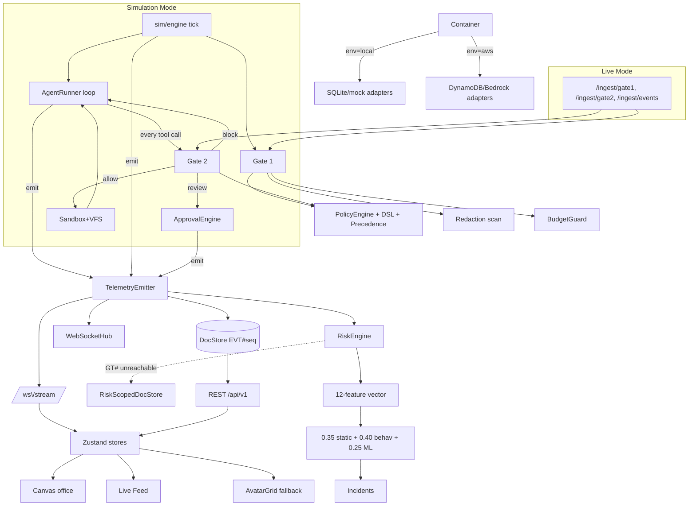

# AgentShield — Codebase Graph (graphify)

> **Companion tooling** (also in this repo): `.freebuff/skills/` — five agent skills
> (core invariants, sim/scenarios, office/frontend, policies/lab, commands/workflows);
> `infra/mcp/agentshield_mcp_server.py` + `.mcp.json` — an MCP server exposing
> `agentshield_graph_query`, `agentshield_task`, `agentshield_api`, `agentshield_docs`.
> The map of the codebase for humans and agents. Machine-readable twin:
> [`graph.json`](./graph.json). Read this once, then work.
>
> One line on the product: **AgentShield is an airport-security checkpoint for AI coding
> agents** — every model call passes Gate 1, every tool call passes Gate 2, every decision
> emits telemetry, and a 20-employee 2D "digital twin" office renders that telemetry.
> The same core serves simulated employees (Simulation Mode) and real agents over HTTP
> (Live Mode). Nothing about governance differs between the two.

---

## 1. Layer map (top-down)

```
┌─ tooling ─────────────────────────────────────────────────────────────┐
│ tasks.py (28 targets) · packages/contracts/generate.py · infra/scripts│
└──────────────┬────────────────────────────────────────────────────────┘
               ▼
┌─ frontend (apps/web) ─────────────────────────────────────────────────┐
│ App.tsx (one WS for app lifetime) → stores (telemetry | sim) →        │
│ game/ canvas renderer + routes/ console + AvatarGrid fallback         │
└──────────────┬────────────────────────────────────────────────────────┘
               ▼ REST /api/v1 + WS /ws/stream
┌─ api (services/api/agentshield/api) ──────────────────────────────────┐
│ routes_sim · routes_core · routes_policies(+lab) · routes_risk ·      │
│ routes_metrics · routes_ingest (LIVE) · ws · schemas                  │
└──────────────┬────────────────────────────────────────────────────────┘
               ▼
┌─ core domains ────────────────────────────────────────────────────────┐
│ governance/  gate1 · gate2 · policy_engine · dsl · precedence ·       │
│              redaction · budget · approvals · (replay)                │
│ agent/       runner (tool loop) · router+PRICE_TABLE · tools · prompts│
│ sandbox/     executor (no real I/O) · vfs (6 seeded repos)            │
│ sim/         engine (tick loop) · clock · generator · persona+ladder  │
│              scenarios · seed · seed_data · office_map · snapshot     │
│ risk/        engine · scoring · features · baseline · isolation ·     │
│              incidents · scoped_store (GT# guard)                     │
│ telemetry/   emitter (THE choke point) · counters                     │
│ domain/      enums · models · events · generated_events               │
└──────────────┬────────────────────────────────────────────────────────┘
               ▼ 8 ports (DocStore LLM BlobStore EventBus Metrics Queue Secrets Clock)
┌─ adapters ────────────────────────────────────────────────────────────┐
│ local/: SqliteDocStore · FsBlobStore · MemoryBus · AsyncioQueue ·     │
│         StdoutMetrics · DotenvSecrets · MockLLM · OllamaAdapter       │
│ aws/:   DynamoDocStore · S3BlobStore · EventBridgeBus · SqsQueue ·    │
│         CloudWatchEmfMetrics · SecretsManagerSecrets · BedrockAdapter │
└───────────────────────────────────────────────────────────────────────┘
              container.py = the ONLY branch on AGENTSHIELD_ENV
```

---

## 2. The two flows that matter

### A. Simulated session (one tick of Simulation Mode)

```
sim/engine.tick
  → approvals.sweep_expired (sim time)
  → TaskGenerator.should_start/generate (diurnal curve, seeded)
  → ScenarioEngine.plan (injects ladder steps for emp_017, retry loops for emp_014)
  → Gate1.evaluate(RequestContext)            ── scan · budget · policies · precedence
      ALLOW → AgentRunner.run(task, actor)
        loop ≤ 8 iterations:
          LLMPort.complete (MockLLM script | Ollama | Bedrock)
          for each tool call → Gate2.evaluate(ActionContext)
              BLOCK → tool result {"error":"blocked_by_policy"} → model continues
              REVIEW → ApprovalEngine.request → await decide/expire (sim time)
              ALLOW → Sandbox.execute (vfs/seeded draws, never real I/O)
      REDACT → prompt masked, raw → blob store only
      BLOCK  → task terminal, cost counted as waste
  → every step: TelemetryEmitter.emit → docstore(EVT#seq) → bus → WS → metrics → RiskEngine
  → task.completed → RiskEngine.score_session → RiskProfile + incident?
```

### B. Live agent call (Live Mode)

```
POST /ingest/gate1   Bearer token → actor (server-side; role NOT in body)
  → same RequestContext → THE SAME gate1.evaluate → {decision, redacted prompt, routed_model}
POST /ingest/gate2   same ActionContext → THE SAME gate2.evaluate → decision (+approval_id)
POST /ingest/events  detail_type validated against EVENT_TYPES registry → same emitter
```

Mode parity is structural: `/ingest/*` and `sim/` call the identical gate functions. The
only difference is `source: sim|live`, which is telemetry metadata and is **absent from the
policy DSL field allowlists** — a policy cannot behave differently per mode.

---

## 3. Invariants (never break these)

| # | Invariant | Enforced by |
|---|---|---|
| I1 | Vendor SDKs (`boto3`, `aiosqlite`, …) only inside `adapters/<env>/` | ruff banned-api + `tests/test_architecture.py` (AST) |
| I2 | Only `container.py` imports `adapters/` | same AST guard |
| I3 | Only `config.py` reads `AGENTSHIELD_ENV`; only `container.py` branches on it | same AST guard |
| I4 | `risk/` has no path to ground-truth labels | AST guard (imports) + `RiskScopedDocStore` raises on `GT#` + vector-equality test |
| I5 | `TelemetryEmitter.emit()` is the single event choke point | convention stated in `emitter.py`; nothing else constructs `EventEnvelope` |
| I6 | Gates are pure: context in → `DecisionResult` out; caller persists/emits | `gate1.py`/`gate2.py` docstrings + shared code path |
| I7 | Precedence `block > review > redact > allow` is fixed; Gate 2 has no redact | `precedence.py`; `PolicyCreate` rejects redact@gate2 |
| I8 | Fails closed: any gate exception → `BLOCK` (`gate_error`) | gate `evaluate()` wrappers |
| I9 | Ordering is always by `seq` (monotonic per-run), never wall time | `emitter._next_seq` atomic `$add` |
| I10 | Expiry/sweeps run on `clock.sim_ts`, never wall time | `approvals.sweep_expired`, engine tick |
| I11 | Raw secrets never leave Gate 1; raw prompt only in blob store | `redaction.py` + `tasks.py check-secrets` canary scan (must be 0) |
| I12 | Sim determinism: everything seeded from `run.seed`; `advance()` forces MockLLM | `sim/persona.seeded_rng`; `repro_check` |

Design goals when in conflict (from `docs/DESIGN.md` §1, in order): mode parity →
portability → determinism → evidence integrity → explainability → demo legibility.

---

## 4. Node index (what lives where)

### Governance (`services/api/agentshield/governance/`)
- **gate1.py** — request governance: 7-secret scan → pre-flight budget → policy match → resolve. Budget outranks policy by design. Route override can downgrade the model.
- **gate2.py** — action governance: `resolve_resource()` derives `target_resource`, sensitivity (secret path / prod deploy ⇒ CRITICAL), scope/branch/host flags. No redact.
- **policy_engine.py** — linear scan over cached policies per gate; cache invalidated **on write only**; append-only versioning (`V#` + `CURRENT`).
- **dsl.py** — 11 ops, 3 combinators, per-gate field allowlists (no `source`); unknown field is a validation error with JSON path and a "did you mean".
- **precedence.py** — fixed ranking; priority decides attribution only; ties break on policy id (stable trace).
- **redaction.py** — masks `<<REDACTED:type:sha256[:4]>>`; event findings carry detector+mask only.
- **budget.py** — employee then team (×0.8) pre-flight; message names the dollar figure.
- **approvals.py** — immutable terminal states (2nd decide ⇒ 409); `approve_session` grants `tool|resource|env` for that task only.
- **telemetry/replay.py** — Policy Lab replays stored `context_snapshot`s; headline number is `newly_blocked_previously_succeeded` (the false-positive proxy).

### Agent + sandbox (`agent/`, `sandbox/`)
- **runner.py** — tool-use loop; **a block is a tool result, not an exception** (the model's reaction is adversarial telemetry); repeat-digest window = 5 sim-min.
- **router.py** — `PRICE_TABLE` is the single source of every cost figure; `price_for` never raises; local prices mirror cloud so demos hold.
- **tools.py / prompts.py** — 8 closed tool schemas (Converse shape); prompt embeds `task_type=` so the mock branches on the same surface.
- **executor.py / vfs.py** — fully simulated, seeded; no network, no real deploys; secret files exist so blocking them is a real event.

### Simulation (`sim/`)
- **engine.py** — 60-sim-second ticks; speeds 1/10/100; downshift on overrun; ≤4 concurrent sessions; `advance()` forces MockLLM + drains.
- **generator.py** — diurnal curve (this is what makes `offhours_frac` a usable feature); ~6% prompts carry seeded fake secrets.
- **persona.py** — 6 archetypes × jitter; the **adversarial ladder** (days 1-3 baseline → 4-5 recon → 6-7 credential probing → 8-9 egress → 10-11 volume → 12+ restricted ops) and the two decoys (sloppy intern, release week).
- **scenarios.py** — the ONLY producer of ground truth (`emitter(..., ground_truth=...)` → `GT#`).
- **seed.py / seed_data.py** — Acme Payments: 4 teams, 6 repos, 20 employees (emp_017 adversarial, emp_014 sloppy), 13 policies.
- **office_map.py / snapshot.py** — desks assigned server-side; snapshot carries the `seq` cursor so the office rehydrates honestly.

### Risk (`risk/`)
- **engine.py** — observes every event; scores at `task.completed`; baseline updates **after** scoring.
- **scoring.py** — `risk = 0.35·static + 0.40·behavioural + 0.25·ml`; `explain()` is the single source of plain-language wording.
- **features.py** — the 12-feature vector; z-scores clipped ≥ 0; Shannon entropy over repos.
- **baseline.py** — Welford one-pass stats vs the person's **own** history; archetype fallback < 20 sessions ⇒ `low_confidence`.
- **isolation.py** — IsolationForest, unsupervised, seeded, refuses < 50 sessions; percentile-ranked to 0-100.
- **incidents.py** — opens at ≥70 for 2 consecutive sessions or any static-critical; merges within 24 sim-hours; evidence capped at 40.
- **scoped_store.py** — runtime label isolation (`LabelLeakError` on `GT#`).

### Telemetry + domain
- **emitter.py** — atomic `seq`, durable write first (3 retries → `dead-letter.jsonl` + `degraded` flag), fan-out that can never fail the emit.
- **counters.py** — six counter families maintained on write with `$add`; "waste prevented" defined once (`WASTE_STATUSES`).
- **domain/models.py** — `EmployeePublic` lacks `scenario_profile` **at the type level**; `policy_view()` excludes `source`; `Task.transition_to` enforces the FSM.

### API (`api/`)
- `routes_sim` (runs/control/advance/state) · `routes_core` (employees/tasks/events/approvals — `/tasks/{id}` = full trace in one query) · `routes_policies` + lab (versioned CRUD, `/validate`, `/fields`) · `routes_risk` (leaderboard + `/explain`) · `routes_metrics` (team risk = **max** of members; `why_high` names evidence) · `routes_ingest` (Live Mode; token→actor server-side; 100 rps/token) · `ws` (seq-cursor replay, gap>500 ⇒ resnapshot, 15s heartbeat).

### Frontend (`apps/web/src/`)
- **App.tsx** — one WebSocket for the app's lifetime; all routes.
- **stores/** — `telemetryStore` (WS-owned; ring buffers 2000/400/200; pause buffers) vs `simStore` (REST-owned; `applyEvent` folds events into avatar FSM; anomaly overlay with hysteresis 70/60). They never overlap, so nothing reconciles them.
- **lib/api.ts + ws.ts** — typed fetch (`ApiError{code,field}` powers editor underlining); reconnect resumes from `lastSeq`.
- **game/** — canvas renderer: RAF loop + camera, pre-rendered room backgrounds, pixel sprites, DOM HUD plates/pills/popover. Reads stores; holds no authority. **AvatarGrid** is the card fallback reading the same store.

### Tooling
- **tasks.py** — `setup dev check seed seed-history advance demo evaluate export-dataset contracts check-secrets repro-check train-risk …` (cross-platform Makefile replacement).
- **packages/contracts/generate.py** — `events.schema.json` → committed Pydantic + TS types (`tasks.py contracts`).
- **infra/scripts/evaluate.py** — the ONLY reader of `GT#`; recall/precision/FP split by decoy source; asserts PRD targets; warns recall ≈ 1.0 means label leakage.
- **tests/** — contract suites parameterised over local+moto; `test_architecture.py` AST guard (with a sanity check it scans ≥ 20 files).

---

## 5. Mermaid view (paste into any renderer)



---

## 6. Key/record layout (the single-table world)

| Key | Holds |
|---|---|
| `RUN#<id>` + `META` / `EMP#…` / `TASK#<ts>#…` / `EVT#<seq:012d>` / `RISK#…` / `SESSION#…` / `BASELINE#…` / `ARCHBASE#…` / `INC#…` / `CTR#…` / `GT#<seq>` | run, employees, tasks, events, risk profiles, session vectors, baselines, incidents, counters, **labels (risk cannot read)** |
| `TASK#<id>` + `META` / `REQ#…` / `ACT#<seq>` / `APPR#…` | full task trace in one partition (single-query payoff) |
| `POLICY#<id>` + `V#…` / `CURRENT`; `POLICIES#<gate>` GSI | append-only policy versions |
| `APPRIDX#<id>`; `RUN#<id>#APPR#<status>` GSI | approval direct lookup + queues |
| `REPO#<name>` + `FILE#<path>` | the virtual repository trees |
| `SEQ#<run>` / `EVENT` | the atomic event counter |
| blob `raw/{task_id}/prompt.json` | the ONLY place a raw prompt value exists |

Zero-padding in sort keys is load-bearing: lexicographic == numeric ordering.

---

## 7. How to do common things

```bash
python tasks.py setup        # venv + pip + npm + .env
python tasks.py seed         # 20 employees, 6 repos, 13 policies
python tasks.py seed-history # +14 sim-days so baselines exist
python tasks.py dev          # API :8000 + web :5173
python tasks.py demo         # unattended 5-beat demo (deterministic)
python tasks.py evaluate     # detection recall/precision vs ground truth
python tasks.py check        # lint + types + tests + build (both sides)
python tasks.py check-secrets# canary scan; MUST report zero
python tasks.py repro-check  # same seed twice => identical event hash
python tasks.py contracts    # regenerate generated_events.py + generated.ts
```

Live Mode walkthrough: `python infra/scripts/reference_client.py --run-id <run>`
(gate1 redaction → gate2 allow → gate2 block → deploy approval → ingest event).
Stream tail: `python infra/scripts/ws_tail.py --run-id <run>`.
